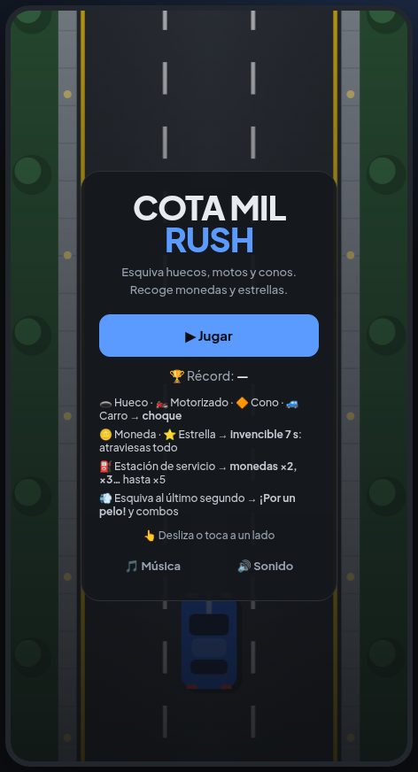
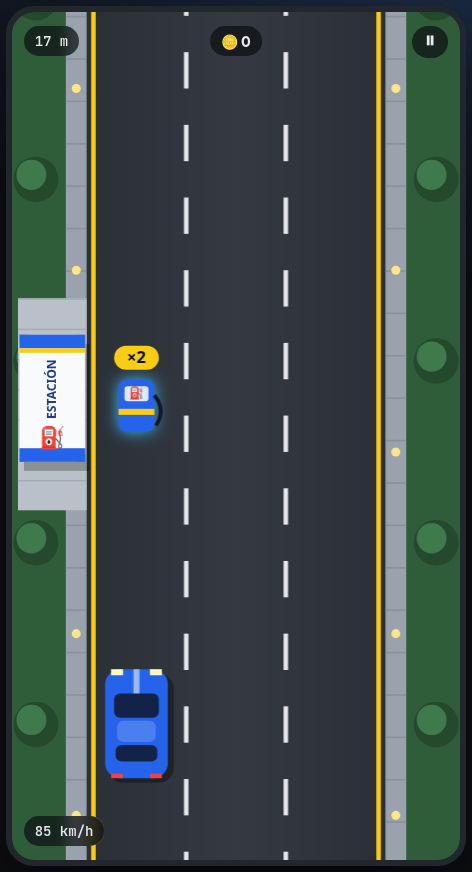
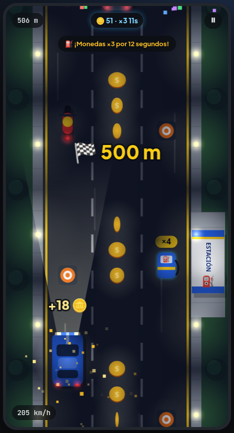
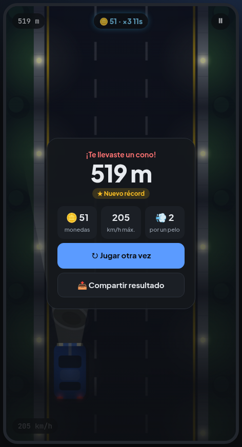
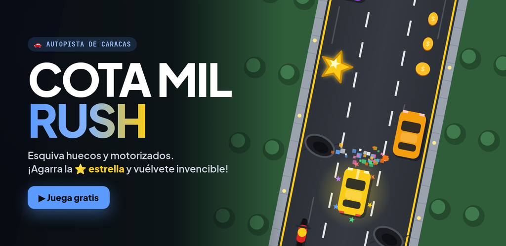

# 🚗💨 Cota Mil Rush

[](https://github.com/alezzz18/cota-mil-rush/actions/workflows/deploy.yml)

Juego de carro en una autopista de Caracas: esquiva **huecos, motorizados, conos y carros**, recoge **monedas** y **estrellas** (te vuelven invencible), pasa por las **estaciones de servicio** para multiplicar tus monedas y aguanta lo más que puedas mientras la velocidad sube y **cae la noche**.

🎮 **Jugar:** https://alezzz18.github.io/cota-mil-rush/

| Menú | De día: estación de servicio | De noche: faros y combo | Fin de partida |
|---|---|---|---|
|  |  |  |  |

<p align="center"></p>

## 🕹️ Cómo se juega

| | PC | Celular |
|---|---|---|
| Cambiar de carril | ← → o A / D | Deslizar o tocar a un lado |
| Pausa | P o Esc | Botón ⏸ |
| Empezar / reintentar | Enter o Espacio | Botón |

- 🕳️ Hueco · 🏍️ Motorizado · 🔶 Cono · 🚙 Carro → **choque**
- 🪙 Moneda → suma · ⭐ **Estrella → invencible 7 s**: el carro brilla en colores y rompe todo lo que toca (y da metros extra)
- ⛽ **Estación de servicio** → multiplicador de monedas ×2, ×3… hasta ×5 durante 12 s (cada estación lo sube uno más)
- 💨 **¡Por un pelo!** → esquiva algo en el último segundo y ganas metros; si encadenas varios seguidos, sube el combo
- 🌙 **Día y noche:** a los 40 s atardece y luego oscurece; manejas con los faros, entre farolas y luces traseras. Después amanece y se repite.
- 🏁 Cada 500 m hay celebración con confeti.
- La velocidad sube poco a poco y las filas de obstáculos se acercan.
- Tu récord se guarda en el navegador y puedes **compartir tu resultado**.

## ✨ Lo técnico

- **TypeScript + Canvas 2D**, sin motores ni librerías de juego. Todo el arte se dibuja con código (sin imágenes) y se adapta a la densidad de cada pantalla.
- **Motor del juego separado** ([`src/game/engine.ts`](src/game/engine.ts)): estado y reglas sin DOM ni dibujo, con aleatoriedad reproducible por semilla.
- **Nunca es imposible:** cada fila deja un carril libre al que se puede llegar desde *cualquier* carril libre de la fila anterior, y los vehículos lentos no bloquean el paso.
- **18 pruebas (Vitest)**, incluida una en la que un conductor automático juega **40 partidas de 2 minutos** sin chocar: si él puede, una persona también.
- **Música de fondo original, "Cota Mil Nights"**, estilo synthwave y generada en vivo con Web Audio: batería ochentera, bajo de sierra, acordes que respiran con el bombo (*sidechain*), arpegio con eco, melodía con vibrato y reverberación. Acelera con el carro, sube de tono con la estrella y se oscurece de noche.
- **Noche con luces reales:** una capa de oscuridad a la que se le "recortan" los faros y las farolas (`destination-out`), más brillos aditivos encima.
- **Sonidos sintetizados** (monedas, estrella, estación, por un pelo, choque, récord), vibración en el celular, partículas, sacudida al chocar y pausa automática al cambiar de pestaña.
- Bucle a 60 fps con `requestAnimationFrame` y paso de tiempo limitado.

```
src/
├── game/engine.ts        reglas: movimiento, generación de filas, colisiones, puntaje
├── game/engine.test.ts   pruebas del motor
├── render/sprites.ts     carro, motos, huecos, conos, monedas, estrellas y estaciones dibujados con Canvas
├── render/renderer.ts    vía, noche y luces, efectos, textos y partículas
├── audio.ts              efectos con Web Audio
├── music.ts              música de fondo synthwave (secuenciador + efectos)
├── storage.ts            récord y preferencias
└── main.ts               bucle, controles, pantallas y compartir
```

## 🖼️ Portadas

En [`promo/`](promo/) están las portadas (Play Store 1024×500, banner 2048×1000 y vertical 1080×1920 para el celular), dibujadas con los mismos sprites del juego: `npm run dev` y abrir `/promo/portada.html` o `/promo/portada-movil.html`.

## 🚀 Ejecutar en local

```bash
git clone https://github.com/alezzz18/cota-mil-rush.git
cd cota-mil-rush
npm install
npm run dev      # http://localhost:5173
npm test         # pruebas del motor
```

Cada *push* a `main` ejecuta tipos, pruebas y build, y publica en GitHub Pages.

## 👤 Autor

**Alejandro Gutiérrez** · Desarrollador Full Stack
[Portafolio](https://alezzz18.github.io) · [GitHub](https://github.com/alezzz18)

## 📄 Licencia

[MIT](LICENSE)
